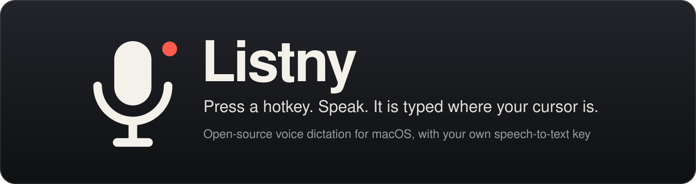
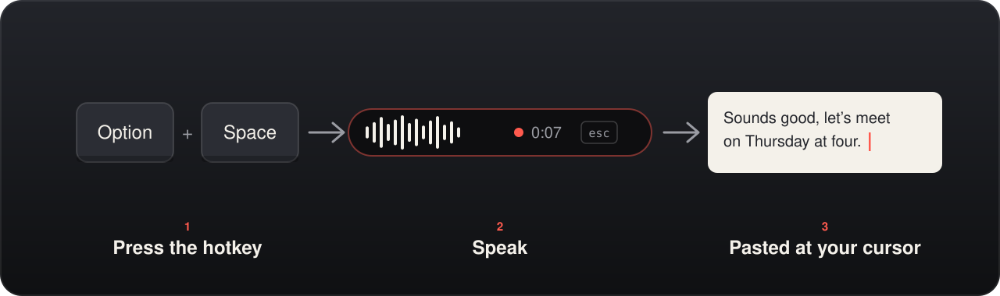
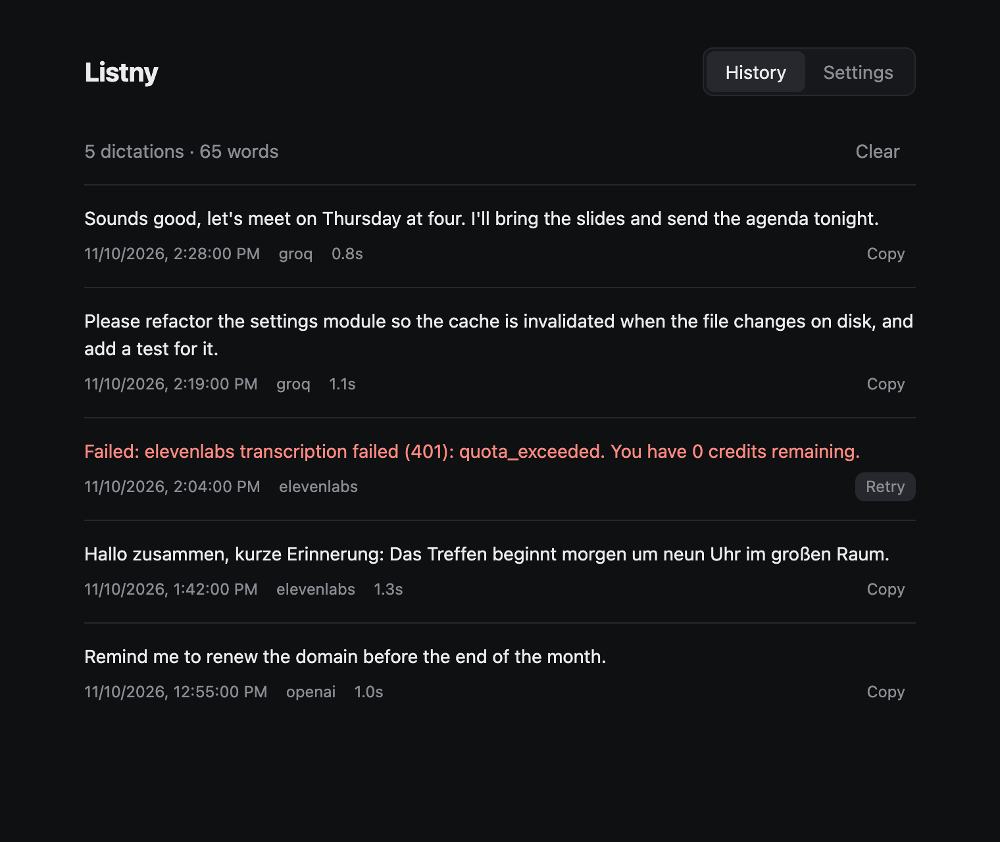
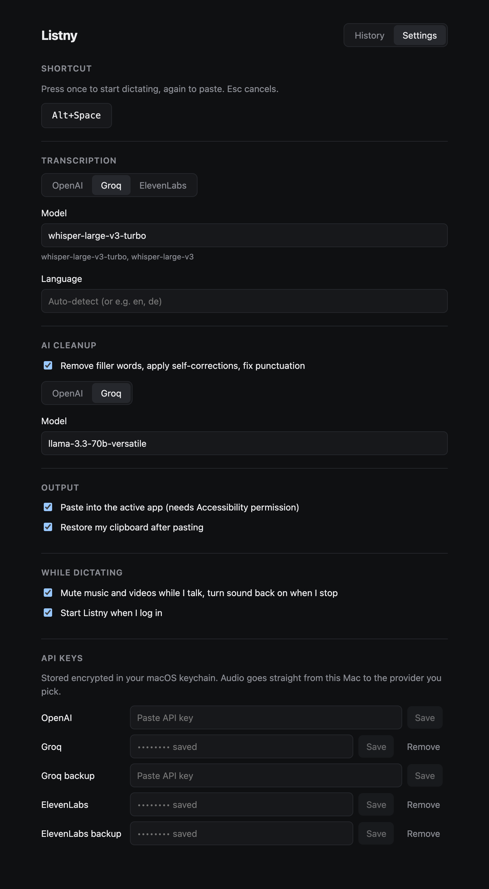

<div align="center">



### Talk instead of typing, in any app on your Mac

**Press a hotkey, speak, press it again. The text is pasted where your cursor is.**<br>
**Open source, no subscription: you plug in your own speech-to-text key.**

[](https://github.com/kaiser-data/listny/releases/latest)

[](https://github.com/kaiser-data/listny/actions/workflows/ci.yml)

[](LICENSE)


</div>

> **Try it in two minutes**
> 1. Download the DMG from the [latest release](https://github.com/kaiser-data/listny/releases/latest) (`arm64` for Apple Silicon, `x64` for Intel) and drag **Listny** into Applications.
> 2. Listny is not notarized by Apple yet, so the first start needs one extra step: run `xattr -dr com.apple.quarantine /Applications/Listny.app` in Terminal, then open the app.
> 3. Paste an API key from OpenAI, Groq or ElevenLabs into the settings window that opens. Groq and ElevenLabs have free plans.
> 4. Click into any text field, press **Option+Space**, speak, press **Option+Space** again.
>
> With Homebrew, steps 1 and 2 are one command: `brew install --cask kaiser-data/tap/listny`



## The idea

Speaking is several times faster than typing, and modern speech-to-text is good enough to trust with real messages. The polished dictation apps are subscriptions, and your voice goes through their servers.

Listny is the small, inspectable version: a menu-bar app that records while you talk, sends the audio **straight from your Mac to the provider you chose**, and pastes the result. You pay the provider for what you use, which for everyday dictation is often nothing.

| | Subscription dictation app | Listny |
| --- | --- | --- |
| Cost | Monthly fee | Free app. You pay your speech-to-text provider, often within its free plan |
| Where audio goes | The vendor's servers | Directly to OpenAI, Groq or ElevenLabs, with your own key |
| Out of credits | Upgrade the plan | Add a backup key; Listny switches to it automatically |
| Source | Closed | MIT-licensed, about 1,300 lines you can read |
| Failed dictation | Usually gone | Audio is kept and can be retried from the history |

## What it looks like

<p align="center"></p>

| History | Settings |
| --- | --- |
|  |  |

The screenshots show the real interface with demo data ([how they are made](docs/screenshots.py)).

## What it does

- **Dictate anywhere.** A global hotkey (default **Option+Space**, configurable) starts and stops recording. **Esc** cancels.
- **Stays out of the way.** No Dock icon and no window: a small pill at the bottom of the screen shows a level meter and a timer, and the app you are typing in keeps the focus.
- **Three providers.** Pick the one you like, and change the model name in settings.

  | Provider | Default model |
  | --- | --- |
  | OpenAI | `gpt-4o-mini-transcribe` |
  | Groq | `whisper-large-v3-turbo` |
  | ElevenLabs | `scribe_v1` |

- **Backup key.** Add a second key per provider, for example a second account. When the first is out of credits or rejected, the same dictation is retried with the backup, and Listny remembers which key worked.
- **Optional AI cleanup.** An OpenAI or Groq chat model removes filler words, applies spoken corrections (*"at 3, no wait, at 4"*) and fixes punctuation.
- **Rests & Lyrics.** Listny cuts your dictation at your pauses and transcribes each piece while you keep talking. The words so far appear above the pill, the text is ready about a second after you stop, however long you talked, and long pauses are never uploaded, so they cost nothing. Each piece is also typed straight into the field your cursor is in, so you watch your text grow while you talk (off while AI cleanup is on, which needs the whole text). Esc stops typing; what is already typed stays. If a piece fails, the whole recording is transcribed and the complete text goes to your clipboard. Turn Rests off in the settings to send one recording per dictation.
- **Quiet while you talk.** Music and videos are muted during a dictation and come back when you stop. If sound was already off, Listny leaves it off.
- **Nothing gets lost.** Every dictation is in the history. If transcription fails, the audio is saved and can be retried.
- **Any language** your provider supports. Leave the language field empty to auto-detect, or set a code such as `de`.

## Permissions

macOS asks for two permissions on first use:

| Permission | Why |
| --- | --- |
| **Microphone** | To record while you dictate. |
| **Accessibility** | To press ⌘V for you. Without it, the text is copied to the clipboard and you paste it yourself. |

## Privacy

- **Audio** goes from your Mac to the provider you picked, over HTTPS, and nowhere else. There is no Listny server.
- **API keys** are encrypted with the macOS keychain (Electron `safeStorage`) and never leave the main process.
- **History** (your transcripts) is stored as plain JSON on your Mac in `~/Library/Application Support/listny/`, readable only by your user. Clear it in the history tab.
- **Failed recordings** are kept in the same folder until you retry or clear them.
- **No telemetry**, analytics or update checks.
- **The log** at `~/Library/Logs/listny/main.log` records hotkey presses, state changes and errors. It never contains dictated text or keys.

## What it costs

The app is free. Speech-to-text is billed by your provider, at its current prices.

One measured data point: ElevenLabs charged about 1.1 credits per second of audio in our use, so the 10,000 credits of its free plan covered roughly 150 minutes of speech a month.

## Limitations

- **macOS only.** There is code for Windows and Linux paste and mute, but it is untested and no builds are published.
- **Not notarized.** The app is signed ad hoc, so macOS needs the `xattr` step above, and it may ask for Microphone and Accessibility permission again after an update.
- **The Intel build is untested.** It is built by CI; development happens on Apple Silicon.
- **Toggle, not hold-to-talk.** Electron's global shortcuts cannot see a key release.
- **Live text comes per phrase, not per word.** Lyrics shows a phrase once you pause after it. Each piece is transcribed without the others as context, so a word at the start of a piece is now and then recognised differently than in one long recording.
- **Cloud only.** There is no on-device model yet.

## Stack

| Layer | Tech | Why |
| --- | --- | --- |
| Shell | Electron 45 | One codebase for tray, global hotkey, microphone and a non-activating overlay window |
| UI | React 19 + Vite | Two tiny pages: the recording pill and the settings/history window |
| Speech-to-text | OpenAI, Groq, ElevenLabs HTTP APIs | No SDKs: three `fetch` calls with a deadline |
| Paste | CoreGraphics key event via `osascript` (JXA) | Works without a native module; falls back to System Events |
| Secrets | Electron `safeStorage` | Keys are encrypted with the macOS keychain |
| Packaging | electron-builder | DMG and zip for Apple Silicon and Intel |

There are no runtime dependencies; everything in `package.json` is a build tool.

## Repo layout

```
electron/
  main.cjs        tray, hotkey, recording pill window, the dictation pipeline, log
  transcribe.cjs  provider calls, backup-key fallback, cleanup prompt
  paste.cjs       clipboard + ⌘V, then restores the previous clipboard
  audio.cjs       mutes system output during dictation and restores it
  settings.cjs    settings, history, saved recordings, encrypted keys
  preload.cjs     the narrow bridge between windows and the main process
src/
  pill.jsx        records the microphone (WebM/Opus) and draws the level meter
  hub.jsx         history and settings
test/             unit tests for the transcription module
build/            app icon and the code-signing hook
packaging/        Homebrew cask template
docs/             images, the release guide and the screenshot script
```

## Run it from source

```bash
git clone https://github.com/kaiser-data/listny.git
cd listny
npm install
npm start          # builds the UI and starts the app

npm test           # 10 unit tests
npm run check      # syntax check, tests and UI build
npm run dist       # writes release/Listny-<version>-arm64.dmg and .zip
```

Requires Node 22 or later and macOS 13 or later.

`npm run dist` signs the app with the certificate named in `LISTNY_SIGN_IDENTITY` if your keychain has it, otherwise ad hoc. A stable certificate keeps the Microphone and Accessibility permissions across rebuilds.

To set keys without the settings window, start the app once with `LISTNY_KEY_OPENAI`, `LISTNY_KEY_GROQ`, `LISTNY_KEY_ELEVENLABS` or their `_BACKUP` variants set; it stores them encrypted and exits.

## Contributing

Bug reports and pull requests are welcome. See [CONTRIBUTING.md](CONTRIBUTING.md), and [docs/RELEASING.md](docs/RELEASING.md) for how releases are cut.

## What's next

Apple notarization · hold-to-talk · streaming transcription · on-device Whisper · Windows and Linux builds

---

MIT licensed. Built by [kaiser-data](https://github.com/kaiser-data). Never commit API keys: Listny keeps them in the keychain, and `.env` files stay out of git.
